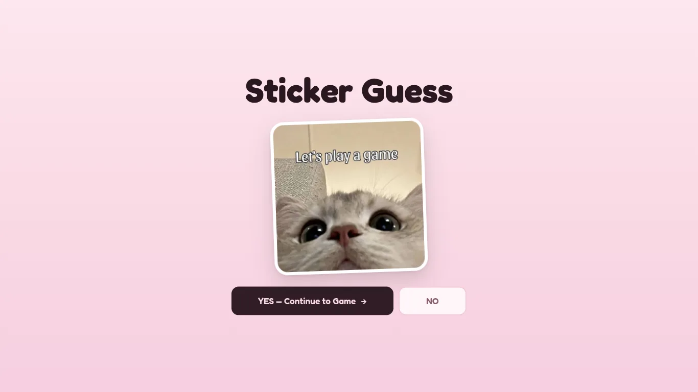
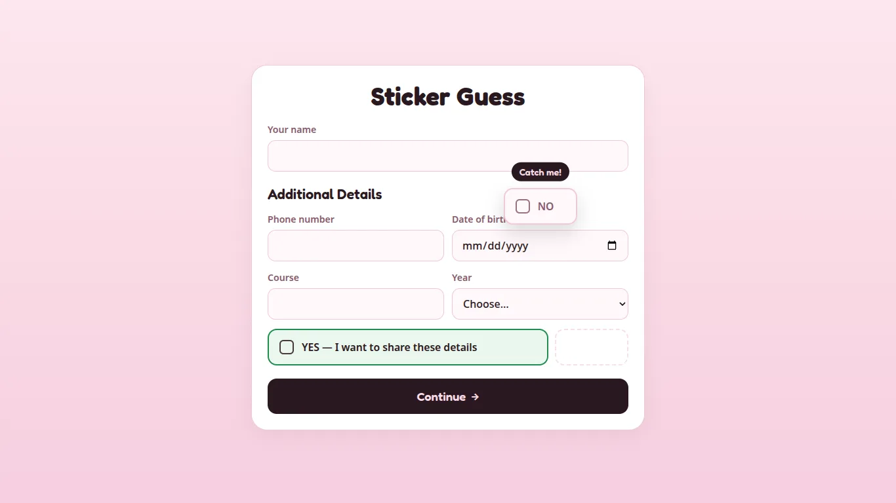
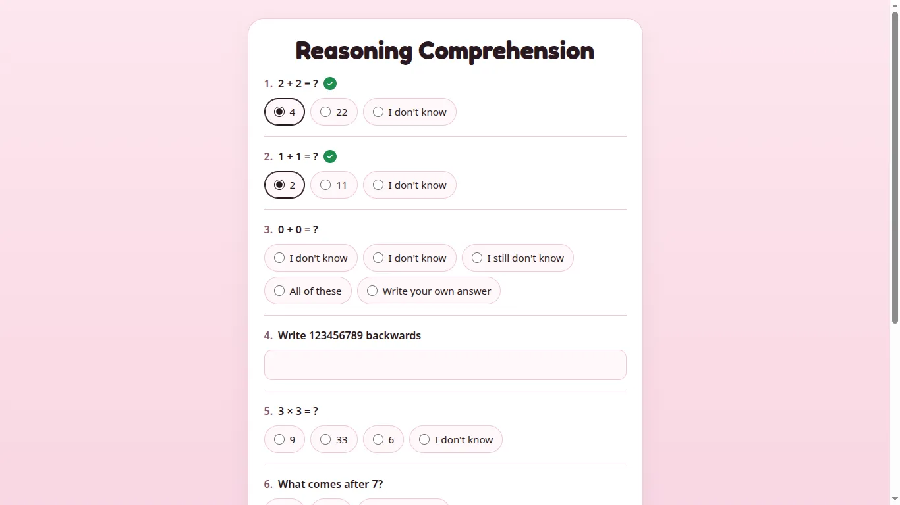
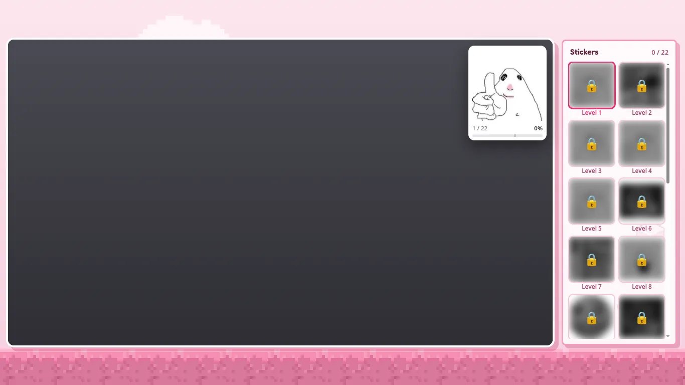
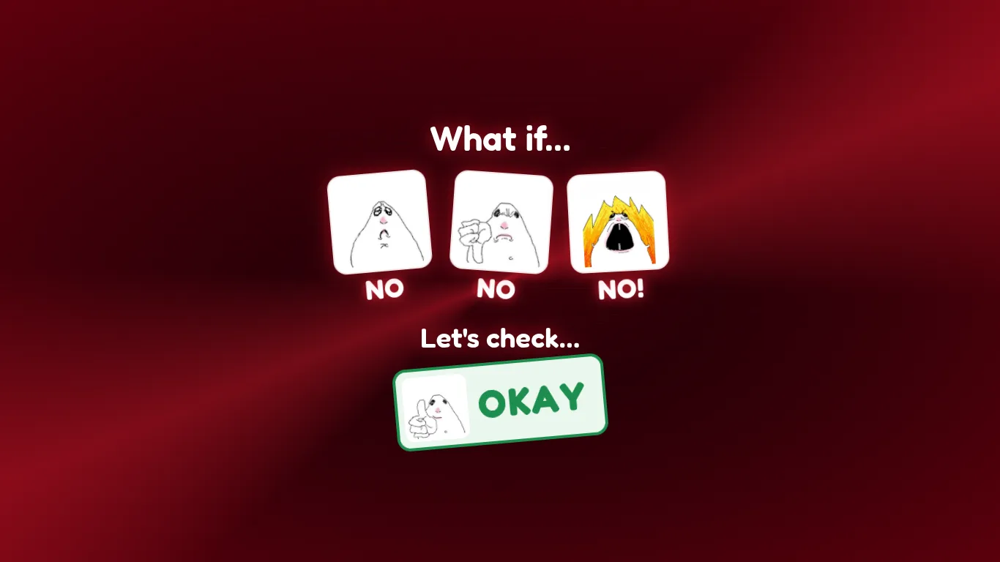
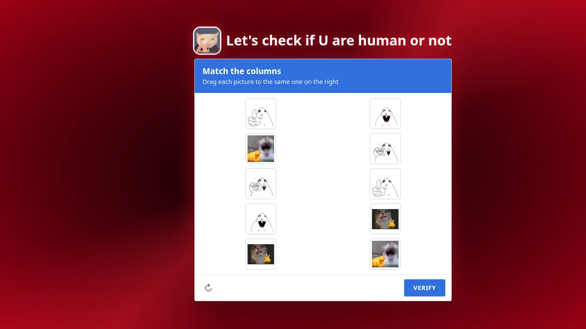
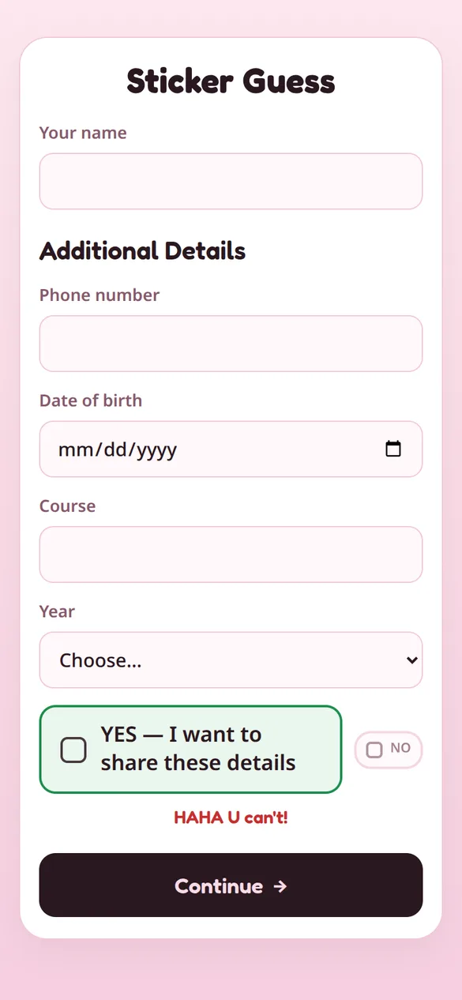
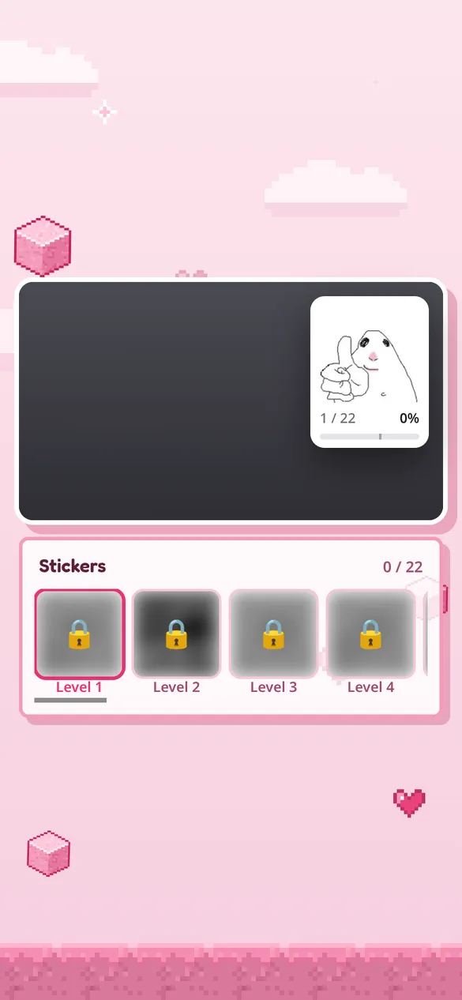

# Sticker Guess 🐹

A cute little prank game to send to a girl you like 😉 (or any friend).
It starts as an innocent "let's play a game" page, and ends with her making faces at the webcam to unlock meme stickers.

**▶ Play it:** https://sticker-guess.vercel.app

| | |
|---|---|
|  |  |
| "Let's play a game". NO isn't really an option | The NO box runs away: *Catch me! … U can't win!* |
|  |  |
| A very serious "Reasoning Comprehension" test | The meme hunt: copy the meme to unlock 22 stickers (taken with a fake, blank camera) |
|  |  |
| Mid-game the screen cracks and a red alarm goes off | …and she has to prove she's human |

## How it plays

1. **Let's play a game**: pressing NO just gets a 😝 sticker, so YES it is.
2. **A little form**: name, phone, birthday… The NO box runs from the mouse; on phones it shrinks with every tap and disappears.
3. **Reasoning Comprehension**: 2 + 2, 0 + 0 (*I still don't know*), write 123456789 backwards…
4. **The meme hunt**: the camera watches her hands and face. Copy the meme in the corner and it unlocks.
5. **7 seconds in**: the glass cracks, a siren goes off ("What if U are not a human?"), and she has to solve a picture captcha before the game continues.
6. **The end**: Play again, or leave a star rating and a comment.

**Moves:** 👍 thumbs up · 👎 thumbs down · ☝️ point · 🤙 shaka · 🤘 rock · 🫶 heart hands · 🙏 steeple fingers ·
🤫 shush · 🤔 hand on chin · 🙆 hand on head · 💪 flex · 😊 smile · 😂 laugh · 😱 scream · 👀 side-eye · 🔍 lean in close

## Phone or laptop

It works on both: just open the link and allow the camera.

| | Laptop / PC | Phone |
|---|---|---|
| Camera | webcam | front (selfie) camera |
| The NO box | runs away from the mouse | stays put, but shrinks with every tap (*Don't do it!* → *HAHA U can't!*) and vanishes on the 3rd |
| Game screen | stickers and memes beside the camera | stickers and memes under the camera (held sideways, it looks like the laptop) |
| Captcha | drag with the mouse | drag with a finger, or tap a picture and then its twin |
| Speed | smooth | older phones can be slower (it falls back from GPU to CPU by itself) |

<p>
  
  &nbsp;
  
</p>

Tested in Chrome and Firefox; not tested on iPhone Safari yet.

## How it works

- Everything runs **in the browser**: [MediaPipe Tasks Vision](https://ai.google.dev/edge/mediapipe/solutions/vision/gesture_recognizer)
  (GestureRecognizer + FaceLandmarker) on WebAssembly/WebGL. The video never leaves the device.
- `gestures.js` checks the model's gesture labels with landmark rules and adds poses it doesn't know (shaka, rock, heart, …).
  `face.js` reads the 52 face blendshapes (smile, scream, …) and head pose. `stabilizer.js` keeps memes from flickering.
- Plain HTML/CSS/JS in `public/`: no backend, no build step, no npm dependencies.
- The hand rules were tuned on HaGRID photos and checked on a separate test split (thumbs up 31/33, point 33/36,
  rock 30/32, heart 50/51; 1 wrong meme in 238 "no gesture" hands). They haven't been measured on live webcam video yet.

## Run it yourself

```bash
git clone https://github.com/ayushcpp/sticker-guess.git
cd sticker-guess
npm run dev          # → http://localhost:5173  (no npm install needed)
for f in tests/*.test.mjs; do node --test "$f"; done   # 215 tests
```

The camera only works on `http://localhost` or `https://`, so to try it on a phone, use the live link.

**Make it yours**
- Get the details by email: make a free [Web3Forms](https://web3forms.com) key and put it in `SHARE.accessKey` in `public/js/config.js`.
- Memes: drop images into `public/memes/` and list them in `MEMES` in `public/js/config.js`.
- Deploy: import the repo in [Vercel](https://vercel.com/new) (`vercel.json` already serves `public/`).

**Privacy:** nothing is sent unless the player ticks **YES — I want to share these details** (then the details and quiz answers
are emailed to the owner) or presses **Send** on the comment note.

## Credits

[MediaPipe](https://github.com/google-ai-edge/mediapipe) (Apache-2.0) · [Fredoka](https://fonts.google.com/specimen/Fredoka) font (OFL) ·
side-eye hamster from [catherpiee/hammyhamster](https://github.com/catherpiee/hammyhamster) ·
test landmarks derived from [HaGRID](https://github.com/hukenovs/hagrid) (CC BY-SA 4.0) · memes belong to their creators.
